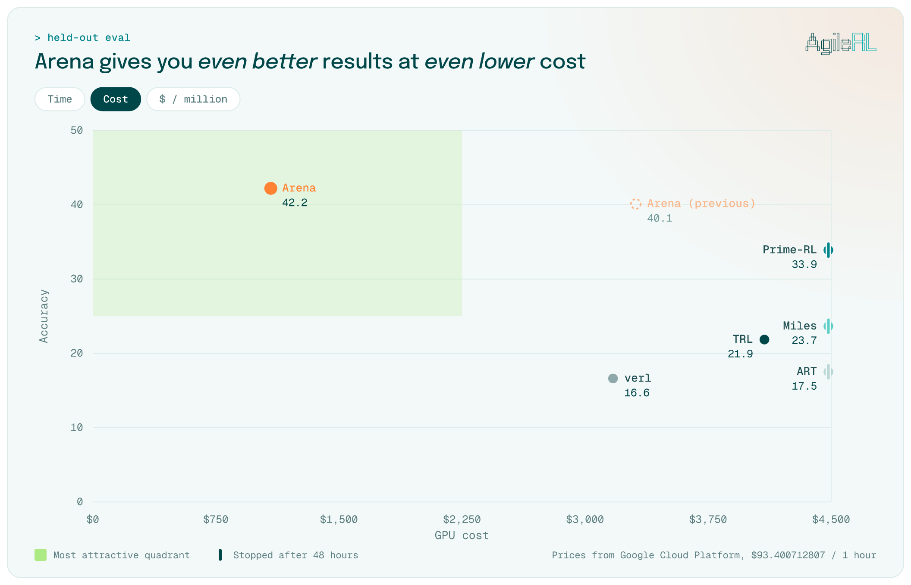

<p align="center">
  
</p>

<p align="center"><b>Train and deploy specialized agents on <a href="https://arena.agilerl.com">Arena</a>, straight from your terminal.</b></p>

`agilerl` is the command-line tool and Python SDK for Arena, AgileRL's post-training platform.

## What is Arena?

Arena turns open-weight LLMs and VLMs into task-specific agents. It covers supervised fine-tuning, preference tuning, distillation from a teacher model, and single- and multi-turn reinforcement learning, then serves the trained agent for inference.

You don't tune the infrastructure. Arena sizes every job itself, working out the most efficient training setup for the compute you have. Train on our GPUs or bring your own cluster.

Bring your own data and tasks. Upload your own datasets, or recorded conversations with tool calls to train on. For reinforcement learning, upload your own environment as Python code or a package: Arena runs any environment that follows the OpenEnv `reset` / `step` API, and converts gym-style environments for you.

It's fast, too: in our [benchmarks](https://agilerl.com/blog/arena-finishes-awm-in-11-hours), Arena trains faster than the leading open-source RL libraries.

<picture>
  <source media="(prefers-color-scheme: dark)" srcset="https://raw.githubusercontent.com/AgileRL/AgileRL/main/.github/images/awm-scatter-cost-dark.png">
  
</picture>

## What the CLI gives you

- **Experiments as code.** Describe a run in a YAML manifest, keep it in git, and launch it with `arena experiments submit`.
- **Know before you spend.** `arena memory estimate` tells you whether a run fits your GPUs before you launch it, and `arena memory solve max_model_len` finds the longest context you can train at.
- **Check your inputs.** `arena env validate` tests your environment before any GPU time is used.
- **The whole platform from your shell.** Create projects and datasets, list GPU types, track experiments and checkpoints, register your own cluster, and generate client code for a deployed agent.
- **A Python SDK.** Use `from agilerl import ArenaClient` in scripts, notebooks and CI.

## Install

```bash
pip install agilerl
```

`agilerl` supports Python 3.10 to 3.13. To train inside your own Snowflake account, use the Arena Native App from the Snowflake Marketplace.

## Quickstart

Log in once, then submit an experiment from a manifest:

```bash
arena login
arena experiments submit manifest.yaml
```

Writing a manifest, preparing datasets and environments, and deploying your agent are all covered in the [Arena docs](https://docs.arena.agilerl.com/).

## Docs

The [Arena CLI guide](https://docs.arena.agilerl.com/cli) covers every command, or you can run `arena --help` to see them in your terminal.

## Migrating from `agilerl-arena`

If you were using `agilerl-arena`, uninstall it first, then install `agilerl`:

```bash
pip uninstall -y agilerl-arena
pip install -U --force-reinstall agilerl
```

Both packages ship the `arena` command, so uninstalling `agilerl-arena` removes it. `--force-reinstall` puts it back even when `agilerl` is already installed, for example after the CLI upgraded itself.

Then change your imports from `agilerl.arena.*` to `agilerl.*`, for example `from agilerl import ArenaClient`.

## Looking for the AgileRL framework?

Before 3.0, `agilerl` was our open-source reinforcement learning framework. From 3.0, `agilerl` is the Arena CLI, and installing it replaces the framework in the same environment. To keep using the framework, install it in a separate virtualenv:

```bash
python -m venv .venv-agilerl2
.venv-agilerl2/bin/pip install 'agilerl<3'
```

To downgrade an environment that already has `agilerl` 3, reinstall `agilerl-arena` 1.x afterwards. Both it and `agilerl` 3 ship the `arena` command, and removing `agilerl` 3 deletes it:

```bash
pip install 'agilerl<3' && pip install --force-reinstall --no-deps 'agilerl-arena<2'
```

The 2.x releases are in the [PyPI release history](https://pypi.org/project/agilerl/#history), and their source is under the `v2.*` [tags on GitHub](https://github.com/AgileRL/AgileRL/tags).

## License and help

`agilerl` is licensed under Apache 2.0 (see [LICENSE](https://github.com/AgileRL/AgileRL/blob/main/LICENSE)). Report bugs and ask questions in [GitHub issues](https://github.com/AgileRL/AgileRL/issues).
